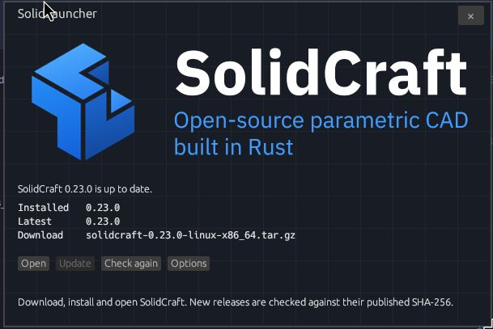

# SolidLauncher

<p align="center">
  
</p>

SolidLauncher downloads, installs, updates, and opens [SolidCraft](https://solidcraft.io). It reads the latest release from [GitHub](https://github.com/tangency-labs/solidcraft), picks the build for this machine, and checks the file against the SHA-256 published with that release before anything is unpacked.

Linux, Windows and macOS are supported.

The window opens floating at 600×400. Its × hides it and leaves an icon in the status bar. Quit is in that icon's menu.

## Install

The [latest release](https://github.com/calmasacow/SolidLauncher/releases/latest) has a tarball per machine. Each installs into your home directory and does not ask for a password.

| Machine | File |
|---|---|
| Linux, 64-bit Intel or AMD | `solid-launcher-<version>-linux-x86_64.tar.gz` |
| Linux, 64-bit ARM | `solid-launcher-<version>-linux-aarch64.tar.gz` |
| Windows, 64-bit Intel or AMD | `solid-launcher-<version>-windows-x64.msi` |
| Windows, ARM | `solid-launcher-<version>-windows-arm64.msi` |
| macOS, Intel or Apple silicon | `solid-launcher-<version>-macos-universal.zip` |

### Linux

`uname -m` prints your architecture. Download that file and `SHA256SUMS.txt` into the same folder. Then:

```sh
sha256sum --ignore-missing -c SHA256SUMS.txt
mkdir -p ~/.local
tar -C ~/.local --strip-components=1 -xzf solid-launcher-<version>-linux-x86_64.tar.gz
```

The check prints `OK` when the tarball matches the published checksum. The unpack puts:

```text
~/.local/bin/solid-launcher
~/.local/share/applications/solid-launcher.desktop
~/.local/share/icons/hicolor/256x256/apps/solid-launcher.png
```

The icon is also installed at 48, 64, and 128 pixels. `~/.local/bin` has to be on `PATH`. Check with `command -v solid-launcher`. If that prints nothing, add this line to your shell startup file and open a new terminal:

```sh
export PATH="$HOME/.local/bin:$PATH"
```

Start it:

```sh
solid-launcher
```

The window opens, and an icon stays in the status bar. The × hides the window. Quit is in the icon's menu. The first launch turns on Start on login and Start minimized, so the next login stays in the bar until you click the icon. Change those under Options.

SolidCraft is not in this tarball. **Update** in the window installs it when you ask.

### Windows

Run the `.msi`. It installs for you alone, into `%LOCALAPPDATA%\\Programs\\SolidLauncher`, and never asks for administrator rights, so it works on a machine where you are not an admin. It adds a Start Menu entry and an entry in Add or remove programs.

Check the download first:

```powershell
Get-FileHash -Algorithm SHA256 solid-launcher-<version>-windows-x64.msi
```

Compare that against `SHA256SUMS.txt`. The first run shows a SmartScreen warning, because the installer is not signed: **More info** then **Run anyway**.

A `.zip` is published beside the `.msi` for anyone who would rather unpack it by hand, or whose machine will not run an installer. It holds the same `solid-launcher.exe`.

**What the installer checks.** It refuses to install on anything older than Windows 10 and says so, rather than installing something that will not start. It does *not* check for the Visual C++ runtime, because there is nothing to check: the program is linked with a static C runtime, so `VCRUNTIME140.dll` is not needed. The graphics driver cannot be checked by an installer at all, so the Windows build draws through DirectX 12 instead of OpenGL — that works even on a machine running Microsoft's Basic Display Adapter, whose OpenGL is too old for the renderer the other platforms use.

### macOS

Unpack the zip and drag `SolidLauncher.app` into your Applications folder. Check the download first:

```sh
shasum -a 256 -c SHA256SUMS.txt --ignore-missing
```

SolidLauncher is a status bar app: it has no Dock icon, and its window opens from the bar icon. If the release was not signed, the first start needs a right-click on the app and then **Open**; see [docs/signing.md](docs/signing.md).

## Where SolidCraft is installed

On Linux, SolidLauncher installs the official tarball. It is unpacked into the home directory, the same layout as installing it by hand, and it does not ask for a password.

```text
~/.local/opt/solidcraft-<version>-<os>-<arch>/
~/.local/bin/solidcraft
~/.local/bin/solidcraft-cli
~/.local/bin/solvecraft
~/.local/bin/solvecraft-cli
```

On Windows there are two ways, and **Options** chooses between them. The portable zip is the default, because it matches the promise the Linux install makes: one user, no password.

| Method | Where it goes | Administrator |
|---|---|---|
| Portable zip | `%LOCALAPPDATA%\Programs\SolidCraft\solidcraft-<version>-windows-<arch>\` | no |
| Installer (MSI) | `%ProgramFiles%\SolidCraft`, for everyone on the machine | yes, a UAC prompt |

The installer also registers the SolidCraft file types and an entry in Add or remove programs, which a portable copy cannot. A `method` file beside the install records which was used, so SolidLauncher knows where to look next time.

On macOS, `SolidCraft.app` is copied out of the release's disk image into `~/Applications`, which needs no password. One copy exists at a time and each update replaces it, so there is nothing to sweep up and **Remove old versions** is not shown. The version is read from the bundle, so a copy you dragged across yourself is found too.

SolidCraft's own disk image is ad-hoc signed and not notarized, so SolidLauncher clears the quarantine flag after the download matches the SHA-256 the release published. Without that, every update would need a right-click and **Open**.

The `solvecraft` names stay so a launcher pinned before SolidCraft 0.8 keeps working. A file already in `~/.local/bin` that is not a symlink is left alone.

Downloads are cached in `~/.cache/solid-launcher/downloads`. A cached file is reused only when its SHA-256 still matches the release.

## Updates

SolidLauncher checks once when it starts, then once an hour while it stays open. **Check again** in the window, and **Check for updates** in the tray menu, check immediately.

A newer release than the installed copy posts one desktop notification for that version. The next launch notifies again if that version is still waiting. Nothing installed does not notify, and a check that fails does not notify.

**Update** installs that release. Older version folders stay in place unless **Remove old versions** is on.

## Options

Options sits beside the status line. The three checkboxes are stored in `~/.config/solid-launcher/settings.json`.

| Option | Default | What it does |
|---|---|---|
| Start on login | on | Writes `~/.config/autostart/solid-launcher.desktop`. Turning it off removes that file. |
| Start minimized | on | Login starts with `--hidden`, so no window is mapped until the icon is clicked. |
| Remove old versions | off | Deletes older `~/.local/opt/solidcraft-*` trees that contain `bin/solidcraft`. Never the copy linked from `~/.local/bin/solidcraft`, and never when SolidCraft was not installed through SolidLauncher. |

The tray icon is a StatusNotifierItem named `solid-launcher`. Left click shows or hides the window. The menu is Show SolidLauncher, Check for updates, and Quit.

## Build

Rust 1.85 or newer.

Every platform is built and released from CI; see `.github/workflows/release.yml`. The test suite covers the Windows install layout and the archive guards on any host, so `cargo test` on Linux exercises them too.

```sh
cargo run -p solid-launcher             # window, and an icon in the bar
cargo run -p solid-launcher -- --hidden # bar icon only
cargo run -p solid-launcher -- --check  # installed version and the latest release
cargo test --workspace
```

A release is published by pushing a tag such as `v0.1.0`. The tag has to match the version in `Cargo.toml`. The release page includes the install steps above.

## Licence

SolidLauncher is [MIT](LICENSE-MIT) or [Apache-2.0](LICENSE-APACHE).

The SolidCraft mark, the raster icon, and the window banner are SolidCraft's brand, used here only to identify that app. See [ATTRIBUTION.md](ATTRIBUTION.md). They are not covered by the licence above.
